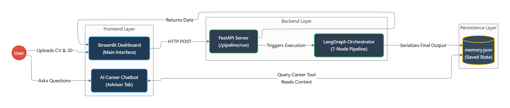
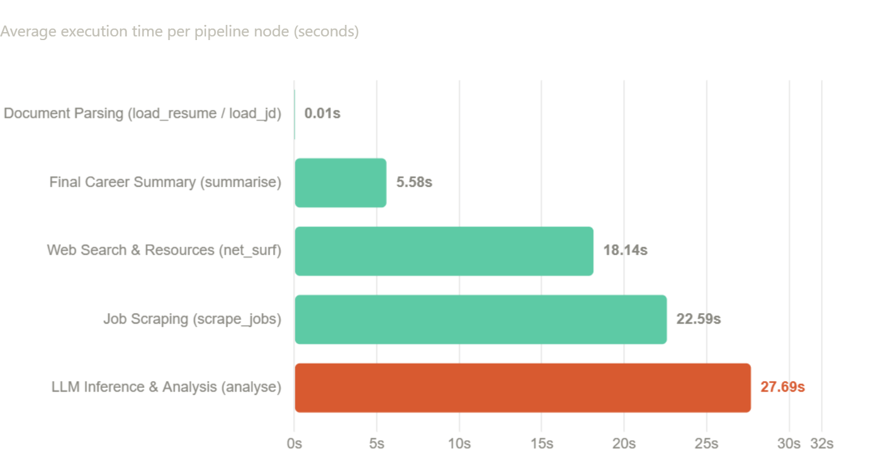

<h1 align="center">
  UpskillxAI
</h1>
<p align="center">
  <em>An Intelligent, Agentic Career Orchestration Platform</em>
</p>

<p align="center">
  
  
  
  
  
</p>

---

##  Table of Contents
- [Overview](#overview)
- [The Problem](#the-problem)
- [Our Solution](#our-solution)
- [System Architecture](#system-architecture)
- [Performance Benchmarks](#performance-benchmarks)
- [Key Features](#key-features)
- [Installation & Usage](#installation--usage)

---

##  Overview

**UpskillxAI** is an end-to-end, multi-agent AI pipeline designed to stop candidates from applying to jobs blindly. 

By taking a user's Resume and a target Job Description (JD), the system autonomously calculates a deterministic ATS match score, identifies exact semantic skill gaps, and aggressively scrapes the web for live job listings and curated learning paths—all orchestrated via a highly parallelized **LangGraph Directed Acyclic Graph (DAG)**.

---

##  The Problem

1. **The Black Box of ATS:** Candidates apply to hundreds of jobs without understanding why they are automatically rejected by Applicant Tracking Systems.
2. **Keyword vs. Semantic Matching:** Traditional resume analyzers look for exact keyword matches. They fail to understand that a "Frontend Developer" applying for "DevOps" lacks deep architectural skills.
3. **Fragmented Workflow:** Discovering what skills you lack, finding high-quality resources to learn them, and finding jobs that fit your newly acquired skills currently takes hours of manual searching across multiple platforms.

---

##  Our Solution

We engineered a centralized orchestration platform that handles the entire pipeline in under 60 seconds:
1. **Document Ingestion:** Uses Reducto API and PyMuPDF to extract text from any format cleanly.
2. **Resilient AI Brain:** Utilizes a fallback chain (`Gemini 2.5` → `Groq Llama 3.3`) strictly bound to Pydantic schemas to output deterministic JSON skill gap analysis.
3. **Parallel I/O Processing:** Instead of sequential loading, LangGraph executes headless Selenium web scrapers (Naukri/LinkedIn) and Tavily API searches at the *exact same time*.
4. **Contextual Memory:** All parsed data is serialized to a persistent state, empowering a localized Chatbot Agent to converse with the user about their specific profile.

---

##  System Architecture



The platform is divided into three distinct layers:
* **Frontend:** A responsive Streamlit dashboard with Session State memory to prevent data-wiping on refresh.
* **Backend:** A FastAPI server invoking the LangGraph orchestrator.
* **Persistence:** A localized JSON memory store bridging the gap between the heavy background pipeline and the lightweight conversational agent.

---

##  Performance Benchmarks



By architecting the pipeline as a LangGraph DAG, we separated Compute-bound tasks (LLM Inference) from I/O-bound tasks (Web Scraping). 

* **Sequential Execution Wait Time:** ~67 Seconds
* **Our Parallel DAG Wait Time:** ~49 Seconds
* **Net Latency Reduction:** **~35%**

---

##  Key Features

- **Multi-Model LLM Fallback:** Zero-downtime inference with automatic routing to secondary models if the primary API hits rate limits.
- **Dynamic DOM Scrapers:** Custom Selenium-based headless browsers with explicit `WebDriverWait` states to extract React-based Job Portals bypassing anti-bot blockers.
- **Strict JSON Enforcement:** Regex sanitization combined with Langchain structured outputs ensures the UI never crashes due to markdown hallucinations.
- **"Ghost Link" Extraction:** Cleanly scrapes LinkedIn job details without triggering CAPTCHAs or requiring authentication.
- **Memory-Injected Agent:** A specialized Chatbot tool (`query_career_memory`) allows the LLM to access the user's hard drive state securely, ensuring 0% hallucination on ATS scores.

---

##  Installation & Usage

### 1. Clone the repository
```bash
git clone https://github.com/yourusername/AI_FOR_EDU_NEW.git
cd AI_FOR_EDU_NEW
```

### 2. Install dependencies
```bash
pip install -r requirements.txt
```

### 3. Setup Environment Variables
Create a `.env` file in the root directory:
```env
GEMINI_API_KEY=your_google_key
GROQ_API_KEY=your_groq_key
TAVILY_API_KEY=your_tavily_key
```

### 4. Run the Backend & Frontend
Boot up the FastAPI server and Streamlit dashboard:
```bash
# Run the FastAPI Backend (if running decoupled)
fastapi dev src/backend/fastapi_ends/api_endpoint.py

# Run the Streamlit Dashboard
streamlit run src/frontend/frontend.py
```
## Career Advisor chatbot, embeddings and RAG

Full documentation is in [docs/](docs/README.md): architecture, embeddings, RAG design, MongoDB Atlas setup, chatbot, prompt scripting, experiment log and roadmap.

```bash
python -m src.rag.ingest --sources all          # build the vector index (Atlas if MONGODB_URI is set, else local)
python -m src.eval.run_prompt_eval --router-only # check the career/study scope guardrail
```
