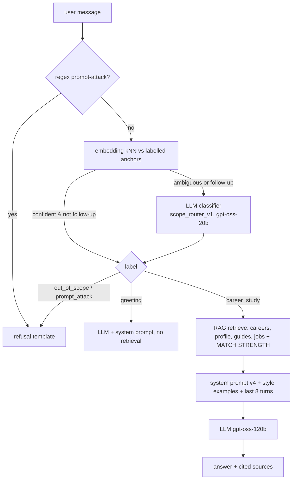

# Career Advisor chatbot

A "ChatGPT for career and study only". It covers both journeys of the project doc: (A) a student with an analysed resume and JD, and (B) a student unsure of their target role, who is matched against the career dataset and asked clarifying questions when information is missing. It answers questions about careers, job search, resumes and ATS, interviews, skills, learning paths, courses, certifications and studying, grounded in the user's analysed profile and our knowledge base. It politely refuses everything else.

## 1. Turn flow (`src/backend/chatbot.py → answer()`)



Refusals cost **zero LLM calls**. A refusal names what the bot *can* help with and suggests an example question.

## 2. Scope guardrail (`src/backend/scope_router.py`)

The guardrail has three layers, cheapest first:

| Layer | Catches | Cost |
|---|---|---|
| Regex | "ignore previous instructions", "system prompt", "you are now", "DAN" … | ~0 ms |
| Embedding kNN (k=5, weighted vote) over `src/prompts/scope_examples.json` (63 labelled messages, 4 labels) | Clear cases | median 9 ms, p95 16 ms, no API |
| LLM classifier (`scope_router_v1.md`) with chat history | Ambiguous messages (top sim < 0.70 or vote share < 0.80) and all short follow-ups | ~300–600 ms |

A fourth layer of defence is the system prompt itself (v4): scope rules 1–3 make the main LLM refuse anything that slips through. The eval measures this layer separately with `--router off`.

**Training the router** needs no code changes. When a real message is misrouted, add it, or a paraphrase, to the right list in `scope_examples.json`. Re-run `python -m src.eval.run_prompt_eval --router-only` to confirm nothing regressed.

Labels:
- `career_study`: answer with RAG.
- `greeting`: hi, thanks, "what can you do". Answered by the LLM without retrieval.
- `out_of_scope`: refused.
- `prompt_attack`: refused.

## 2-v5. Precise answers and feedback learning
Since E32 every question is profiled (type, item count, length, format). Retrieval is tuned to the type, weakly related chunks are filtered out, and prompt v5 receives a per-question **answer contract** plus guidance learned from 👍/👎 on similar questions. Details: [feedback_learning.md](feedback_learning.md).

## 2-v6. Self-check, scope and the question queue (E34)
- **Generate → verify → revise (prompt v6).** After the first draft, `src/backend/answer_check.py` checks it against the question:
  - exact item count
  - word limit
  - Yes/No verdict for yes/no questions
  - a one-line verdict for "am I a fit / should I apply"
  - the ATS number for ATS questions
  - every real skill gap for "what am I missing"
  - the JD's requirements for JD questions
  - the gap's name in the first sentence for "what should I learn first"

  On any violation the model revises **once** with the exact problems listed, so only failing drafts cost a second call. The Explain panel shows when an answer was revised.
- **Scope (advisor v6 + router v2):** one shared definition. *In scope:* careers, job search, resumes, interviews, salaries, skills, learning, higher education (degrees, admissions, SOPs, entrance exams), studying (techniques, exam prep, explaining concepts to learn them) and student/workplace life as it affects study or career (exam stress, time management, first job). *Out of scope:* everything else. Graded homework gets help understanding and outlining, but isn't written for the student.
- **Question queue:** the chat box stays usable while an answer is being generated. A newly sent question interrupts the run, joins the queue, and all queued questions are answered in order ("queued, will be answered next"). A question leaves the queue only after its answer has been stored, so an interrupted answer is redone, never lost.

## 2a. Without an LLM
The advisor also runs with **no generator** (`LLM_PROVIDER=none`) or degrades to it when every LLM fails: answers are composed from the cited records (`src/backend/extractive_answer.py`). See [keyless_mode.md](keyless_mode.md).

## 2b. User interface (Streamlit, `src/frontend/advisor_ui.py`)
The **Career Advisor is the first tab and is always available**, with or without an analysed CV. Before E24 it only appeared after Analyze Profile, which hid journey B entirely.

| Element | Purpose |
|---|---|
| Status chips | Profile state (loaded: role + ATS / not analysed), knowledge base (MongoDB Atlas or local, 2,899 careers), live prompt version, "career & study questions only" |
| Starter questions | *Using your profile* (gaps, ATS, matching jobs; shown only when a profile exists) and *Exploring careers & studies* (career fit, creative interests, interview prep, study techniques) |
| Answer + **Sources** expander | The `[S#]` citations are listed under each answer (career ids, guide sections, job URLs) |
| **Explain** toggle → "How this answer was built" | Router label + method (regex/kNN/LLM), latency, answering model, and a table of retrieved records with similarity scores. Made for team discussions, mentor demos and debugging |
| 👍 / 👎 per answer | 👍 saved; 👎 asks *what went wrong* + *what a good answer should include*. Stored in Atlas `feedback_v1` (or a local file) and **used immediately for similar questions** (feedback_learning.md) |
| New chat / Save | Clear the conversation / download it as Markdown |

## 3. Interfaces

**Streamlit**: the "Career Advisor" tab calls `chat_with_agent(st.session_state["chat_messages"])`. The signature is unchanged from the old chatbot.

**REST**: `POST /chat`
```json
{"messages": [{"role": "user", "content": "How can I improve my ATS score?"}], "debug": true}
```
→ `{"reply": "...", "route": {...}, "hits": [...], "latency_ms": 1830}` (`route`/`hits` only when `debug=true`).

## 4. Configuration

| Env var | Default | Meaning |
|---|---|---|
| `CHAT_MODEL` | `groq:openai/gpt-oss-120b` | Answer model. Falls back through `brain._FREE_TIER_MODELS` (gpt-oss-20b → qwen3.8-27b → gemini-2.5-flash). The model that actually answered is logged per turn |
| `ROUTER_MODEL` | `groq:openai/gpt-oss-20b` | LLM used by the scope classifier |
| `PROMPT_ADVISOR_SYSTEM` | `v4` (see `registry.ACTIVE`) | System prompt version (`src/prompts/templates/advisor_system_vN.md`) |
| `SCOPE_ROUTER_MODE` | `hybrid` | `hybrid` \| `knn` \| `llm` \| `off` (`off` is eval only) |
| `SCOPE_KNN_MIN_TOP_SIM` / `SCOPE_KNN_MIN_VOTE_SHARE` | 0.70 / 0.80 | kNN confidence gates |

## 5. Logging and analysis
Every turn appends to `reports/chat_logs/chat_log.jsonl` (git-ignored because it holds user text):
`ts, message, route{label, method, top_sim, vote_share, latency_ms}, system_version, model, error, n_hits, hit_ids, top_score, latency_ms, answer_chars`.

Use it to:
- find misrouted messages, which become new router anchors
- find queries with a low `top_score`, which are gaps in the knowledge base
- track latency

Langfuse tracing in the pipeline can be enabled by adding `LANGFUSE_*` keys.

## 6. What changed from the old chatbot

| Old | New |
|---|---|
| Tool call that pasted the **whole `memory.json`** into a Gemma prompt | Vector retrieval of about 9 relevant chunks + a compact profile header |
| No scope restriction | Three-layer guardrail plus prompt rules |
| Profile data only | Profile + **2,899 career records (source of truth)** + 153 jobs + curated guides |
| No citations | `[S#]` citations and a sources footer with links |
| No evaluation | 32-case eval set, router metrics, LLM judge |
| Primary model `llama-3.3-70b-versatile`, **retired by Groq**, so every call silently used fallbacks | `gpt-oss-120b`, with the answering model logged |

The old tool (`src/backend/tools/memory_tool.py`) is no longer used and is kept for reference.
