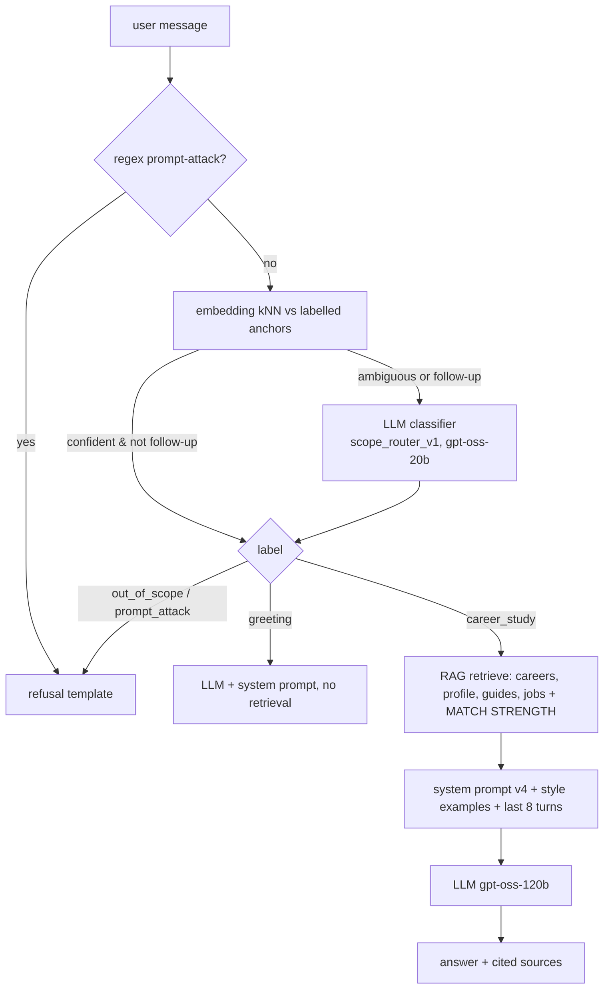

# Career Advisor chatbot

A "ChatGPT for career and study only". It covers both journeys of the project doc: (A) a student with an analysed resume and JD, and (B) a student unsure of their target role, who is matched against the career dataset and asked clarifying questions when information is missing. It answers questions about careers, job search, resumes and ATS, interviews, skills, learning paths, courses, certifications and studying, grounded in the user's analysed profile and our knowledge base. It politely refuses everything else.

## 1. Turn flow (`src/backend/chatbot.py → answer()`)



Refusals cost **zero LLM calls**. A refusal names what the bot *can* help with and suggests an example question.

## 2. Scope guardrail (`src/backend/scope_router.py`)

The guardrail has three layers, cheapest first:

| Layer | Catches | Cost |
|---|---|---|
| Regex | "ignore previous instructions", "system prompt", "you are now", "DAN" … | ~0 ms |
| Embedding kNN (k=5, weighted vote) over `src/prompts/scope_examples.json` (63 labelled messages, 4 labels) | Clear cases | median 9 ms, p95 16 ms, no API |
| LLM classifier (`scope_router_v1.md`) with chat history | Ambiguous messages (top sim < 0.70 or vote share < 0.80) and all short follow-ups | ~300–600 ms |

A fourth layer of defence is the system prompt itself (v4): scope rules 1–3 make the main LLM refuse anything that slips through. The eval measures this layer separately with `--router off`.

**Training the router** needs no code changes. When a real message is misrouted, add it, or a paraphrase, to the right list in `scope_examples.json`. Re-run `python -m src.eval.run_prompt_eval --router-only` to confirm nothing regressed.

Labels:
- `career_study`: answer with RAG.
- `greeting`: hi, thanks, "what can you do". Answered by the LLM without retrieval.
- `out_of_scope`: refused.
- `prompt_attack`: refused.

## 3. Interfaces

**Streamlit**: the "Career Advisor" tab calls `chat_with_agent(st.session_state["chat_messages"])`. The signature is unchanged from the old chatbot.

**REST**: `POST /chat`
```json
{"messages": [{"role": "user", "content": "How can I improve my ATS score?"}], "debug": true}
```
→ `{"reply": "...", "route": {...}, "hits": [...], "latency_ms": 1830}` (`route`/`hits` only when `debug=true`).

## 4. Configuration

| Env var | Default | Meaning |
|---|---|---|
| `CHAT_MODEL` | `groq:openai/gpt-oss-120b` | Answer model. Falls back through `brain._FREE_TIER_MODELS` (gpt-oss-20b → qwen3.8-27b → gemini-2.5-flash). The model that actually answered is logged per turn |
| `ROUTER_MODEL` | `groq:openai/gpt-oss-20b` | LLM used by the scope classifier |
| `PROMPT_ADVISOR_SYSTEM` | see `registry.ACTIVE` | System prompt version (`src/prompts/templates/advisor_system_vN.md`) |
| `SCOPE_ROUTER_MODE` | `hybrid` | `hybrid` \| `knn` \| `llm` \| `off` (`off` is eval only) |
| `SCOPE_KNN_MIN_TOP_SIM` / `SCOPE_KNN_MIN_VOTE_SHARE` | 0.70 / 0.80 | kNN confidence gates |

## 5. Logging and analysis
Every turn appends to `reports/chat_logs/chat_log.jsonl` (git-ignored because it holds user text):
`ts, message, route{label, method, top_sim, vote_share, latency_ms}, system_version, model, error, n_hits, hit_ids, top_score, latency_ms, answer_chars`.

Use it to:
- find misrouted messages, which become new router anchors
- find queries with a low `top_score`, which are gaps in the knowledge base
- track latency

Langfuse tracing in the pipeline can be enabled by adding `LANGFUSE_*` keys.

## 6. What changed from the old chatbot

| Old | New |
|---|---|
| Tool call that pasted the **whole `memory.json`** into a Gemma prompt | Vector retrieval of about 9 relevant chunks + a compact profile header |
| No scope restriction | Three-layer guardrail plus prompt rules |
| Profile data only | Profile + **2,899 career records (source of truth)** + 153 jobs + curated guides |
| No citations | `[S#]` citations and a sources footer with links |
| No evaluation | 32-case eval set, router metrics, LLM judge |
| Primary model `llama-3.3-70b-versatile`, **retired by Groq**, so every call silently used fallbacks | `gpt-oss-120b`, with the answering model logged |

The old tool (`src/backend/tools/memory_tool.py`) is no longer used and is kept for reference.
